# 08 代表性硬件路径与五站映射（v0.1，2026-11-12）

## 一、结论和状态

**这是推荐方案，没有经用户确认。** 第六节的每一行都等你拍板；在你确认之前，分镜、时间轴和模型都不按它锁定。

- **参考机型**：一款公开手册可查的风冷 8-GPU 服务器（NVIDIA DGX H100/H200，8U）。片中不出现品牌和型号，只借它的结构。**只核了这一款机型**，其它厂商的 8-GPU 服务器在网卡形态和光口位置上不一样（见第七节）。
- **一个比特的路径**（参考机型上查得到的）：
  GPU A 芯片的 PCIe 接口 → 封装 → GPU 托盘电路板 → 中板 →（PCIe 重定时器 / 交换芯片）→ 网卡芯片 → 机箱内部铜缆 → 机箱**后部**的光口笼子 → 可插拔光模块 → 光纤 →（叶 / 脊交换机，片中省略）→ 光纤 → 对端光模块 → 对端网卡 → GPU B。
- **外部审阅指出的问题成立**：片中「出发」站画的串化电路，是 **GPU 芯片自己的 PCIe 接口**里的；直接驱动光模块的是**网卡芯片**里的另一套串化电路。两者的速率和调制方式都不同：

  | | GPU 芯片的接口（参考机型） | 网卡朝光口的接口 |
  |---|---|---|
  | 协议 | PCIe 5.0 | InfiniBand NDR 或 400G 以太网 |
  | 通道数 | 16 条 | 4 条 |
  | 每条通道 | 32 Gb/s | 约 100 Gb/s（以太网口径 106.25 Gb/s） |
  | 调制 | **两级（NRZ）** | **四级（PAM4）**，53.125 GBd |
  | 每条通道的导体 | 一对差分线 | 一对差分线 |

- **和导演倾向不一致的地方有 6 处**，集中写在第六节末尾。最要紧的三处：
  1. GPU 这一侧每条通道是每秒约 320 亿个比特、两级。S03 现在的角注「真实每秒上千亿个」是网卡一侧的数，要改。
  2. S04 里「变模糊」的演示排在路过网卡之前。按真实结构，网卡之前的模糊由板上的重定时器和网卡自己的接收端整理，不归光模块里的 DSP 管。要么把演示挪到网卡之后，要么加角注。
  3. 参考机型的官方配套里，单模模块用的是 EML，短距离更常配多模 VCSEL 模块。片中以「单模硅光模块」为例可以成立，但它是「同一标准的另一种实现」，不是这台机器的原厂搭配，角注要写清。
- 搜索工具：全程 AnySearch（匿名额度），没有切换。AnySearch 抽不了 PDF，6 份公开 PDF 是直接下载后转成文字读的；NVIDIA 用户手册里的 7 张结构图下载后看过原图。
- 核到的程度：〔读〕读过原文或官方页面；〔图〕看过官方原图；〔转〕读的是转载或第三方文件；〔摘〕只看到检索摘要；〔算〕自己算的；〔未查〕没查到来源。来源编号 R1–R25 见文末。

## 二、拓扑图

三种标记：**〔实〕** 片中按真实结构画 · **〔示〕** 片中画成示意 · **〔略〕** 片中省略（角注交代）。
图里实线框 = 〔实〕，长虚线框 = 〔示〕，点线框 = 〔略〕。

```mermaid
flowchart LR
  classDef real stroke:#2b7a4b,stroke-width:2px
  classDef schem stroke:#b8860b,stroke-width:2px,stroke-dasharray: 6 3
  classDef omit stroke:#888888,stroke-dasharray: 2 4,color:#666666

  subgraph SA["服务器 A · 风冷 8-GPU · 8U"]
    direction LR
    A1["GPU A 芯片<br/>PCIe 接口的串化电路<br/>〔示〕S02–S03"]:::schem
    A2["封装叠层<br/>微凸点 / 中介层 / C4 / 基板 / 焊球<br/>〔示：只画到微凸点〕S03 末"]:::schem
    A3["GPU 托盘电路板和中板<br/>差分走线<br/>〔实〕S04"]:::real
    A4["PCIe 重定时器 / 交换芯片<br/>〔略〕"]:::omit
    A5["网卡芯片<br/>重新打包，再串化一次<br/>〔示：路过，不进去〕S04"]:::schem
    A6["机箱内部铜缆（双轴线）<br/>〔实〕S04"]:::real
    A7["机箱后部的光口笼子 OSFP<br/>〔实〕S04 末"]:::real
  end

  subgraph MA["可插拔光模块 A"]
    direction LR
    M1["DSP<br/>〔示：内部不画〕S05"]:::schem
    M2["驱动器<br/>〔示〕S06"]:::schem
    M3["连续光激光器<br/>单独的磷化铟芯片<br/>〔实〕S06"]:::real
    M4["调制器（马赫-曾德尔）<br/>〔实：结构〕〔示：明暗〕S06"]:::real
    M5["模斑转换器和光纤阵列<br/>〔示〕S07"]:::schem
  end

  F1["单模光纤<br/>〔实〕S07–S08"]:::real
  SW["叶 / 脊交换机<br/>每过一台：光 → 电 → 光<br/>〔略〕"]:::omit
  F2["单模光纤<br/>〔实〕S08"]:::real

  subgraph SB["服务器 B · 同样的结构"]
    direction LR
    B1["光模块 B<br/>探测器 / 跨阻放大器 / DSP<br/>〔示〕S09"]:::schem
    B2["光口、内部铜缆、网卡 B<br/>〔略〕"]:::omit
    B3["电路板走线<br/>〔略〕"]:::omit
    B4["GPU B 芯片<br/>PCIe 接口的解串电路<br/>〔示〕S09"]:::schem
  end

  A1 -->|"每条通道一对差分线<br/>32 Gb/s · 两级 · 共 16 条通道"| A2
  A2 -->|"同一对差分线"| A3
  A3 -.->|"PCIe 5.0"| A4
  A4 -.->|"PCIe 5.0 · 16 条通道"| A5
  A5 -->|"4 条通道 · 每条约 100 Gb/s<br/>四级 PAM4（片中画两级）"| A6
  A6 -->|"同上"| A7
  A7 -->|"模块金手指"| M1
  M1 -->|"整理后的电信号"| M2
  M2 -->|"放大后的电信号，加在电极上"| M4
  M3 -->|"连续光 · 约 1310 nm · 硅波导"| M4
  M4 -->|"已调制的光 · 硅波导"| M5
  M5 -->|"芯片对光纤的对接"| F1
  F1 -.->|"MPO-12/APC 连接器"| SW
  SW -.->|"MPO-12/APC 连接器"| F2
  F2 -->|"光纤阵列"| B1
  B1 -.->|"4 条通道 · 四级 PAM4"| B2
  B2 -.->|"PCIe 5.0"| B3
  B3 -->|"一对差分线"| B4
```



**纯文字备用图**（从上到下是信号走的顺序；右边是连接的接口 / 介质）

```
服务器 A（风冷 8-GPU，8U）
  〔示〕GPU A 芯片：PCIe 接口的串化电路                        S02–S03
     │  每条通道一对差分线；32 Gb/s，两级（NRZ）；共 16 条通道
  〔示〕封装叠层：微凸点 → 中介层 → C4 凸点 → 基板 → 焊球       S03 末（只画到微凸点）
     │  同一对差分线
  〔实〕GPU 托盘电路板 → 中板：差分走线                         S04
     ┆  PCIe 5.0
  〔略〕PCIe 重定时器 / 交换芯片
     ┆  PCIe 5.0，16 条通道
  〔示〕网卡芯片：收下 PCIe 数据，重新打包，再串化一次          S04（路过，不进去）
     │  4 条通道，每条约 100 Gb/s，四级 PAM4（片中画两级）
  〔实〕机箱内部铜缆（双轴线）                                  S04
     │  同上
  〔实〕机箱后部的光口笼子（OSFP）                              S04 末
     │  模块金手指
可插拔光模块 A
  〔示〕DSP（内部不画）                                         S05
     │  整理后的电信号
  〔示〕驱动器 ──放大后的电信号──┐                              S06
  〔实〕连续光激光器 ──连续光，约 1310 nm──┤
                                 ▼
  〔实 / 示〕调制器（马赫-曾德尔）：结构按真实画，明暗为示意     S06
     │  已调制的光，硅波导
  〔示〕模斑转换器 + 光纤阵列                                   S07
     │  芯片对光纤的对接
〔实〕单模光纤                                                  S07–S08
     ┆  MPO-12/APC 连接器
〔略〕叶 / 脊交换机（1 台或 3 台，更大的集群 5 台）；每过一台：光 → 电 → 光
     ┆  MPO-12/APC 连接器
〔实〕单模光纤                                                  S08
     │  光纤阵列
服务器 B（同样的结构）
  〔示〕光模块 B：探测器 → 跨阻放大器 → DSP                     S09
     ┆  4 条通道，四级 PAM4
  〔略〕光口、内部铜缆、网卡 B（解串，拆包，再按 PCIe 串化一次）
     ┆  PCIe 5.0
  〔略〕电路板走线
     │  一对差分线
  〔示〕GPU B 芯片：PCIe 接口的解串电路                          S09
```

**另一条路：NVLink。** 参考机型里，同一台机箱的 8 颗 GPU 之间另有专用的直连（NVLink，经 4 颗 NVSwitch 芯片，每对差分线 100 Gb/s、PAM4），全在 GPU 托盘的电路板上，不出机箱〔R1 读 + 图；R9 读〕。**片中讲的不是这一条**：GPU A 和 GPU B 在两台不同的服务器里，走的是「GPU → 网卡 → 光模块 → 光纤」这条网络路径。

## 三、逐段说明表

| # | 段 | 真实情况（参考机型） | 片中怎么画 | 镜头 | 来源和核到的程度 |
|---|---|---|---|---|---|
| 1 | GPU A 芯片 | 8 颗 GPU 装在机箱上层的 GPU 托盘里，俯视是 2 列 × 4 排；同一托盘上还有 4 颗 NVSwitch。大芯片的封装叠层见 FACTS V12 | 〔示〕封装排布是示例结构，不对应具体产品 | S01 末、S02 | R1〔读 + 图〕。封装叠层沿用 FACTS V5、V12 |
| 2 | GPU 侧接口 | PCIe 5.0，16 条通道，每条 32 GT/s（每秒 320 亿个比特），**NRZ 两级**，128b/130b 编码。每条通道 = 发送一对差分线 + 接收一对差分线。16 条合计每个方向 512 Gb/s | 〔示〕S03 的串化电路画的就是这个接口的发送端，只跟其中 1 条通道。画 32 并 1：真实的并行位宽没查到 | S03 | 「8 颗 GPU 各有一条 PCIe Gen5 x16 对主机的链路」：R3〔读，NVIDIA 员工在官方论坛的回复，不是正式文档，**仅单一来源**〕。32 Gb/s：R9〔读〕、R15〔读〕。NRZ、128b/130b、每条通道两对差分线：R11〔读，维基百科，二手〕。512 Gb/s〔算〕 |
| 3 | 芯片 → 封装 | 发送端的输出是一对互补的线，经一对微凸点进中介层，再经 C4 凸点、基板、焊球到电路板。这一对凸点周围是地凸点 | 〔示〕只画到微凸点和中介层表面；凸点周围的连线和地凸点省略；后面几级用 1 帧暗场带过 | S03 末 | 差分：见第五节。「一对信号凸点 + 周围地凸点」〔未查〕。叠层沿用 FACTS V12〔摘〕 |
| 4 | 板上走线 | GPU 托盘电路板 → 中板（手册写明中板负责电源、PCIe、传感器和信号的连接）→ 主板托盘里的网卡转接板。GPU 在参考机型里是先装在一块模组板上、再插到 GPU 托盘的底板上，这一级没查到公开结构图 | 〔实〕一对差分走线、阻焊、过孔；〔略〕模组板到底板的连接器、中板 | S04 前段 | R1〔读 + 图：GPU 托盘图、网卡模块图上的「PCIe Connections to GPU tray through midplane」〕。模组板一级〔未查〕 |
| 5 | 重定时器 / PCIe 交换芯片 | 这台机器里两样都有：主板托盘上 2 颗 72 通道的 PCIe 5.0 交换芯片和 16 通道的 PCIe 5.0 重定时器，GPU 托盘上也有重定时器和 PCIe 交换芯片。**某一颗 GPU 到它对应的网卡，具体经过哪几颗，没查到官方拓扑图** | 〔略〕不画。若采纳第六节「S04 顺序」的改法，用一条角注交代 | S04 | R2〔读：固件清单列出这些器件〕；R15〔读：72 通道、32 GT/s〕；R16〔摘：x16、PCIe 5.0〕。具体连法〔未查〕 |
| 6 | 网卡芯片 | 8 颗网卡芯片（每 4 颗合成一个「网络模块」，共 2 个模块），装在主板托盘里靠近中板的位置，**在机箱中部，不在后面板**。每颗网卡：主机侧 PCIe 4.0 / 5.0，16 条通道，16 / 32 GT/s；网络侧 1 个口，4 条通道 × 每条 100 Gb/s。网卡把 PCIe 数据收下来、解串、按网络协议重新打包，再串化一次 | 〔示〕路过，不进去；标签交代「重新排队，换成更快的节拍」 | S04 | R1〔读 + 图〕；R4〔读：PCIe Gen 4.0/5.0 SERDES @ 16/32 GT/s x16；NDR = 4 lanes × 100 Gb/s per lane；电接口 400GAUI-4 C2M。R4 是插卡版网卡的手册，机内模块用的是同一款网卡芯片，接口参数按相同推定〕。四级 PAM4、53.125 GBd：R5〔读：100G-PAM4〕、R21〔读，二手：4 × 53.125 GBd〕 |
| 7 | 用 RDMA 直通时的数据路径 | GPUDirect RDMA：GPU 和网卡之间用 PCIe 的标准功能直接交换数据，网卡像读写系统内存一样直接读写 GPU 的内存区，**数据不必先拷到主机内存**。条件之一是两者在同一个 PCIe 根下面。数据是否完全不经过 CPU 一侧的 PCIe 端口，取决于 GPU 和网卡是否挂在同一颗交换芯片下，这一点没查到 | 不画。支持「路径上没有 CPU 和内存」这个简化 | — | R10〔读〕 |
| 8 | 网卡 → 光口 | **内部铜缆**（DensiLink，双轴线）：从网卡模块直接拉到机箱后部的光口转接板，跨过 CPU 和内存区。共 4 根，每根带 2 个口（两颗网卡各一个）。长度手册没给 | 〔实〕一段内部铜缆。旁白 n13「走线或铜缆」在这条路径上两样都有 | S04 后段 | R1〔读 + 图：两张图都标了 DensiLink〕。双轴线、支持每通道 112G PAM4：R23〔摘〕 |
| 9 | 光口 | 在机箱**后部**（热通道一侧），主板托盘正中，4 个 OSFP 笼子。每个笼子接两颗网卡的口（2 × 400 Gb/s，共 8 条电通道）。笼子是平顶款（OSFP-RHS，模块高 9.5 mm，散热片装在笼子上），只接受双口、平顶的模块。机箱正面是 12 个风扇模块和 8 块硬盘，**没有光口** | 〔实〕后部的笼子；〔示〕只跟其中 1 条通道 | S01、S04 末 | R1〔读 + 图：后面板图、端口图、正面图〕；R7〔读：「ports on the back of the DGX H100 CPU tray」〕；R6〔读：只接受双口平顶〕；R12〔读：RHS 高 9.5 mm〕 |
| 10 | 模块的电接口 | 金手指上 8 对发送差分线、8 对接收差分线（管脚名 TXnp / TXnn）。每条通道 100 Gb/s PAM4 | 〔实〕金手指；〔示〕只跟 1 对 | S04 → S05 | R12〔读〕；R5〔读〕 |
| 11 | 模块里的 DSP | NVIDIA 自家的双口模块，单模款和多模款的结构图上都标了 DSP。带 DSP 的模块功耗约 15–17 W。也有不带 DSP 的方案（LPO） | 〔示〕内部不画，只画两侧波形；角注全程挂「也有不带 DSP 的方案」 | S05 | R6〔读：PDF 里图上的文字〕；R5〔读：17 W〕；LPO 见 FACTS F6 |
| 12 | 激光器、驱动器、调制器 | 分三种实现：① **硅光**：连续光激光器（磷化铟）+ 硅上的马赫-曾德尔调制器，几条通道可共用激光器；② **EML**：每条通道一颗「激光器 + 电吸收调制器」做在一起的磷化铟芯片〔「每条通道一颗」未查，凭已有知识〕；③ **多模 VCSEL**：激光器直接调制，没有单独的调制器。参考机型的原厂模块：单模款用 EML，多模款用 VCSEL | 〔实〕按硅光方案画：激光器是单独芯片，调制器是毫米级两臂；〔示〕明暗两级 | S06 | 原厂模块用 EML / VCSEL：R6〔读，**仅单一来源**，2024-10 版〕。硅光 DR4 模块存在且符合 400GBASE-DR4：R17〔转〕。硅光可共用激光器：R18〔读〕。连续光 + 马赫-曾德尔：R24〔摘〕 |
| 13 | 模块 → 光纤 | 单模款（2×DR4）：1310 nm，两个 MPO-12/APC 连接器，每个口 4 条光通道、每条 100 Gb/s PAM4，各走一根光纤，不合波；按 DR4 标准每个口 4 根发、4 根收，两个口合计 8 发 8 收（产品页的原话是「using 8 single mode fibers」，没写收发怎么算）。最大 100 m 或 500 m 两档（500 m 按中间有两个配线架算）。多模款（2×SR4）：850 nm，最大 50 m，同样是 MPO-12/APC | 〔示〕模斑转换器和光纤阵列只画外形；〔实〕尺寸比例。片中一条通道对应一根光纤，和 DR4 的并行结构一致 | S07 | R5〔读〕；R6〔读〕；R20〔读，第三方：850 nm、OM3/OM4 30/50 m〕；400GBASE-DR4 的标准条目：R21〔读，二手〕 |
| 14 | 光纤 | 单模（OS2）；模块外面是 MPO-12/APC 多芯跳线，不是双芯 LC 跳线。一份第三方的整套机房参考设计把光纤长度限定在 50 m 以内，并且整套用的是多模模块 | 〔实〕黄色护套的单模跳线、线槽。S08 的「几百米、几公里」是单模光纤的能力，不是这条链路的实际长度 | S07–S08 | R5、R6〔读〕；R19〔读，第三方，**仅单一来源**〕 |
| 15 | 省略的交换层 | 官方参考架构：127 台以内是叶 / 脊两层。同一组（32 台以内）、同一路的两台服务器之间只过 1 台叶交换机；跨组或跨路要过脊，共 3 台。512 台起（16 个单元以上）再加一层核心，最多 5 台。交换机的每个口也是可插拔模块，所以每过一台就多一次「光 → 电 → 光」 | 〔略〕不画，角注「省去中间的交换机」 | S08、S10 | R7〔读〕；R8〔读：表 3.1〕。交换机口上是双口模块：R5〔读〕。「交换芯片内部是电」〔R18 读：交换芯片 SerDes → 模块 DSP → 光〕 |
| 16 | 对端 | 结构相同、方向相反：模块里探测器 → 跨阻放大器 → DSP → 4 条 PAM4 电通道 → 内部铜缆 → 网卡 B（解串、拆包，再按 PCIe 串化）→ 走线 → GPU B 的 PCIe 接收端（解串）。所以接收一侧同样有两次解串 | 〔示〕S09 画模块里的探测、放大，再画 GPU B 里的解串；〔略〕网卡 B 和中间的走线 | S09 | 由 #2、#6、#8 对称推出；没有另找来源 |

## 四、五站映射表

| 站 | 原稿的说法 | 对应的真实硬件段（参考机型） | 镜头 | 和原稿有出入的地方 |
|---|---|---|---|---|
| 一 出发 | GPU 内部的数据并排放着；排成一列，变成一条高速电信号；负责的电路叫 SerDes | GPU 芯片的 PCIe 接口发送端：16 条通道，每条 32 Gb/s，两级 | S02–S03 | ① **片中画的串化电路在 GPU 芯片的 PCIe 接口里**，不是驱动光模块的那一个。② 原稿读起来像是「GPU 的 SerDes 发出的信号一路送到光模块」；实际中间隔着网卡，网卡把数据收下、重新打包、**再串化一次**（4 条通道，每条约 100 Gb/s，四级）。③ 这个接口每条通道是每秒约 320 亿个比特，不是上千亿。④ 片中只跟 16 条通道里的 1 条 |
| 二 电的路 | 在电路板走线或铜缆上跑；越快越远越模糊；常见光模块里设「检修站」DSP | 两小段：(a) GPU → 封装 → 电路板 → 中板 →（重定时器 / 交换芯片）→ 网卡，PCIe；(b) 网卡 → 内部铜缆 → 光口 → 模块里的 DSP，4 × 100 Gb/s PAM4 | S04–S05 | ① 原稿只有一段电的路，真实是两段，中间是网卡。② (a) 段的模糊由板上的重定时器和网卡的接收端整理；**模块里的 DSP 整理的是 (b) 段**。原稿的「检修站」对 (b) 段成立。③ 重定时器其实是同一类「检修站」，片中省略。④「走线或铜缆」在参考机型上两样都有：(a) 是走线，(b) 是内部铜缆 |
| 三 换乘 | 激光器发稳定的光；调制器按 0 和 1 让光一明一暗；驱动器帮忙使劲 | 模块内：连续光激光器 + 驱动器 + 调制器（片中按硅光方案） | S06 | ① 三个器件的分工在硅光和 EML 方案里都成立；多模 VCSEL 方案没有单独的调制器，对不上。② 参考机型的原厂单模模块是 EML，不是硅光。③「一明一暗」是两级；这一段实际是四级 |
| 四 光的路 | 光在光纤里跑；难点是芯片上的光通道和光纤的对接 | 模块内硅光芯片 → 光纤阵列 → 单模光纤 →（交换机）→ 光纤 | S07–S08 | ① 原稿没提交换机；真实路径中间至少过 1 台，每台多一次光电转换。② 原稿说的「对接」是模块内部芯片到光纤那一处；模块外面还有 MPO 连接器的对接，片中不讲。③ 这条链路的实际长度是几十米量级，「几百米、几公里」说的是单模光纤能做到的 |
| 五 抵达 | 感光元件把光变回电流；放大；一列拆回一排，放回 GPU | 模块 B：探测器 → 跨阻放大器 → DSP；然后网卡 B；最后 GPU B 的 PCIe 接收端 | S09 | ① 原稿是「放大之后直接拆回一排放回 GPU」；真实是先在网卡 B 拆一次、重新打包，再按 PCIe 串化送到 GPU B，GPU B 再拆一次。② 片中 S09 画的解串电路在 GPU B 的 PCIe 接口里，和 S03 成镜像 |

**网卡里的第二次串化，片中现在怎么交代**（timeline v0.3）：
- S03，33.6 秒起，角注：「这里画的是 GPU 自己的高速接口；到了网卡，数据还要再排一次队（示例架构）」；
- S04，50.0 秒起，标签：「路过网卡芯片：数据在这里重新排队，换成更快的节拍」。

核对：两条都和事实相符。「更快的节拍」成立（每条通道的符号率从 32 GBd 到 53.125 GBd，每个符号还从 1 个比特变成 2 个）。两点建议：① 网卡做的不只是换节拍，还把数据按网络协议重新打包，标签可以写成「数据在这里重新打包、重新排队，换成更快的节拍」；② S09 的角注现在只有「接收端结构为示意」，对端同样经过网卡，建议补一句（见第六节末尾「必须改的文字」）。

## 五、S03 → S04 的衔接：一条逻辑通道怎样变成两根导体

**现在的镜头方案**：S03 末尾（35.5 秒起）输出驱动把一路信号变成一对互补的线，相机跟着这一对线往下，穿过一对微凸点；S04 接同一对差分走线。

**结论：物理上成立，可以这样拍。** 依据和不准确处如下。

依据（差分输出本身）：
- PCIe 的每条通道由两对差分线组成，发送一对、接收一对，每条通道共 4 根信号线〔R11 读，维基百科，二手；它引的是 PCI-SIG 的入门材料〕。
- 光模块一侧的标准接口同样如此：OSFP 规范写明金手指上有 8 对发送差分线和 8 对接收差分线，管脚成对命名（TX1p / TX1n…），电平类型是 CML〔R12 读〕。
- NVIDIA 在 Hot Chips 2022 的讲稿里直接用「每对差分线 100 Gb/s」作单位〔R9 读〕。
- 差分的定义：两根线上的信号幅度相等、相位相反，接收端取两者之差；这一对导体可以是电路板走线，也可以是双轴线缆〔R13 读，TI 技术文章；R14 读，维基百科〕。

所以从芯片的发送端到下一颗芯片的接收端，这一路始终是两根导体：两个凸点、两条走线，到了内部铜缆是双轴线里的两根芯线。S03 末尾跟着「一对线」穿「一对凸点」，S04 接「同一对走线」，电气上是同一对网络。

不准确处（按影响从大到小）：
1. **「一路变两路」的位置**。片中画成单根串行线到了输出驱动才分成两根。真实的高速发送端里，最后几级的合并电路和驱动器通常本身就是差分电路，并没有一处「单根变双根」的明确分界。属于简化，建议在这里标「示意」。〔未查：没找到能直接引用的公开来源，按通用电路知识判断〕
2. **凸点周围不是空的**。一对信号凸点四周是地凸点和电源凸点，用来给信号做回流和屏蔽；粗模为了看得见把周围 ±36 µm 清空了。现有角注「凸点周围的连线已省略」可以盖住，建议把「地凸点」也写进去。〔未查〕
3. **速率的口径**。S03 末尾和 S04 前段这一对线上跑的是 PCIe：每秒约 320 亿个比特，两级。见第六节末尾。
4. **中间省掉的级数比角注写的多**。除了中介层、基板、焊球，参考机型里 GPU 还先装在一块模组板上，再经连接器接到 GPU 托盘的底板。现有角注「芯片到电路板之间还有中介层、基板、焊球，这里略过」不算错，只是没写全；片中是示例结构，可以不改。〔模组板一级未查〕
5. **走线上的隔直电容**。PCIe 在发送端附近的每根线上要串一颗隔直电容。S04 分镜里的「旁边的电容」如果想画成和这对走线有关，应当是**串在两根线上的一对小电容**，不是摆在旁边。〔未查：凭已有知识，建模前要补来源〕
6. **不是所有芯片间的高速接口都是差分**。有资料提到同一代产品里另有一种短距离的单端接口〔R25 读，个人网页，仅单一来源〕。所以屏幕字不要写成「高速信号都用两根线」，写「这类接口」即可。

亮暗怎么画：按 FACTS V9，微米级视野里整条线同电位，所以两根线、两个凸点应当**交替着一亮一暗、永远相反**；到了 S04 厘米级视野，两条走线上的亮暗图样沿线互补（03 审查表 S04「差分走线」一条已经这样要求）。

**角注备选**（20 字以内）：
- A（推荐）：`一路信号，两根线送：电压一正一反`
- B：`两根线电压相反，接收端只认差值`
- C：`差分：两根线互为镜像，干扰相互抵消`
- 现稿：`一路信号，两根线送：一高一低（差分）`。可以用；「一高一低」容易被理解成固定一根高、一根低，A 的「一正一反」更贴近「永远相反」。

## 六、导演决策表

每一行都是**待用户确认**。改动成本指对已有 S01–S03 粗模和时间轴的影响。

| # | 题目 | 推荐方案（待用户确认） | 事实依据 | 需要你决定什么 | 改动成本 |
|---|---|---|---|---|---|
| Q1 | 路径简化到什么程度 | 画出网卡（路过，不进去）和内部铜缆；省略重定时器、PCIe 交换芯片和中间的交换机，角注交代。**待用户确认** | 参考机型上 GPU 到光口之间必经网卡和一段内部铜缆〔R1 读 + 图〕；交换机至少 1 台〔R7 读〕 | ① 接受「网卡只路过」吗；② S04 里模糊演示和网卡的先后（见表后第 2 条） | 小：v0.3 时间轴已经这样写；S04 还没建模。若调整 S04 内部顺序，只动 S04 的标注时间 |
| Q2 | SerDes 画在哪 | 仍画在 GPU 芯片边缘，明说它是 GPU 自己的接口（示例：PCIe）；网卡里的第二次串化用 S03、S04 各一条文字交代。**待用户确认** | GPU 对主机是 PCIe 5.0 x16〔R3 读，仅单一来源〕；网卡另有一套 4 × 100 Gb/s 的串化电路〔R4 读〕。「串化电路在芯片边缘」〔未查〕 | 角注里要不要出现「PCIe」这个词；还是只写「GPU 自己的高速接口」 | 小：S03 模型不动，只改角注文字和数字 |
| Q3 | 明暗画两级还是四级 | 全片画两级。S03 和 S04 网卡之前的一段，两级就是真实情况；网卡之后和光上是四级，注「实际用四级（PAM4），这里画两级」。**待用户确认** | PCIe 5.0 是 NRZ〔R11 读，二手〕；网卡之后是 100G-PAM4〔R4、R5 读〕 | 接受「前半段两级是真的，后半段两级是示意」这种分段注法吗 | 小：只改 S04、S06 的角注 |
| Q4 | 光模块选哪种做例子 | 以含 DSP 的单模硅光可插拔模块（并行单模，DR4 一类）为例，角注写明「也有 EML、多模 VCSEL、不带 DSP 的方案」。**待用户确认** | 原厂单模模块是 EML，短距离常配多模 VCSEL〔R6 读，仅单一来源；R19 读，第三方〕；硅光 DR4 模块存在并符合同一标准〔R17 转〕；模块里有 DSP〔R6 读〕。**这台机器专用的双口平顶硅光模块，没查到** | 是否接受「例子不是参考机型的原厂搭配」。不接受的话改用 EML：三个器件的讲法不变，但调制器不再是两臂结构，「暗的时候光去哪了」变成被吸收 | 选硅光：小（角注）。改 EML：中（S06、S07 还没建模，但分镜、F8、F9 和 S07 的波导对接都要重写） |
| Q5 | 调制器内部讲不讲干涉 | 不讲；模型建成看得出「分两路再合起来」。**待用户确认** | 这一轮没有新事实 | 同 03 审查表 | 无 |
| Q6 | AI 服务器用哪种形态 | 风冷 8-GPU、8U。**待用户确认** | R1〔读〕：8U、高 356 mm、前进后出风 | 同 03 审查表 | 见「光口在哪一面」 |
| Q7 | 串化电路内部画不画 | 画多级二选一树（32 并 1），标「简化示意」。**待用户确认** | 32 并 1 时并行侧每条线约 1 Gb/s〔算〕；真实接口的并行位宽〔未查〕 | 同 03 审查表 | 无 |
| 新 | 光口在机箱哪一面 | **后面**。第一帧保留冷通道机位，路线从 GPU 往机箱后部走，被机柜挡住的段画虚线（v0.3 的做法）。**待用户确认** | 参考机型光口在后部，正面只有风扇和硬盘〔R1 读 + 图；R7 读〕。有一篇第三方文章写成「前面板」〔摘〕，以官方手册为准 | 备选：第一帧改到机柜背面（热通道），能直接看到光口和成排的黄色跳线，更真实，但要重做 S01 的机位和开头构图 | 保留冷通道：中（S01 粗模的光口位置、机箱内部布局和路线几何要改；这一轮的 S01 粗模如果已经按后部光口改了，剩下的是把网卡挪到机箱中部）。改到热通道：大 |
| 新 | 参考机型 | 以 DGX H100/H200 这一类为参考，片中标「示例结构」，不出现品牌和型号。**待用户确认** | 这一轮只查了这一款：它的手册公开了内部结构图、端口位置和内部线缆〔R1〕。别的厂商多用标准插卡式网卡〔R22 读，媒体，仅单一来源〕；插卡式网卡的光口在卡自己的挡板上、没有内部铜缆，是按插卡的通用结构推断的，没有逐款核对 | 是否接受「只参考一款机型」。内部铜缆是这款机型特有的 | 小 |

### 查到的事实和导演倾向不一致的地方

1. **GPU 一侧的速率和调制**。倾向里没写数；v0.3 的 S03 角注用了网卡一侧的数。事实：GPU 的 PCIe 5.0 每条通道 32 Gb/s、两级，16 条。影响：S03 的「每秒上千亿个」和「慢放约百亿倍」不对（应为每秒约 320 亿个；按粗模串行一拍 0.1 秒算，慢放约 30 亿倍〔算〕）；S04 网卡之前的一段，每个比特在板上长约 5 mm，不是 3 mm（3 mm 对应的是网卡之后的 53.125 GBd）〔算，沿用 FACTS V6 的板上速度〕。
2. **「电的路 = 走线 + 路过网卡 + 内部线缆 + 模块里的 DSP」这条因果链只对后半段成立**。v0.3 的 S04 把模糊演示（44–52 秒）放在路过网卡（50 秒）之前，接着 S05 由模块里的 DSP 来整理。事实：网卡之前那一段的模糊，由重定时器和网卡的接收端整理；模块里的 DSP 整理的是「网卡 → 内部铜缆 → 光口」这一段。
3. **网卡的位置**。倾向和 v0.3 的 S01 镜头说明写的是「后部的网卡和光口」。事实：网卡芯片在机箱中部（靠近中板），只有光口在后面板，两者之间是内部铜缆。
4. **「网卡到光口：内部线缆或走线」**。事实：参考机型是内部铜缆，确定；但这是这款机型的做法，别的厂商多是网卡上自带笼子。
5. **光模块的例子**。倾向是「含 DSP 的硅光可插拔模块」。事实：含 DSP 成立；但参考机型的原厂单模模块是 EML，机房参考设计里短距离配的是多模 VCSEL 模块。硅光模块作为同一标准的另一种实现可以当例子，要注明。
6. **每个光口笼子接的是两颗网卡**（双口模块，8 条电通道、两个 MPO 连接器）。倾向里按「一个网卡一个光口」理解。片中只跟 1 条通道，画面不受影响；模块外形和光纤根数要按双口画，或者标示例。

倾向里和事实一致的：GPU 自己的接口是 PCIe；路径上有 PCIe 交换芯片；网卡每条通道约 100 Gb/s PAM4；光口在机箱后部；模块里有 DSP；中间的交换层可以省略并注明；对端结构相同。

### 如果采纳上面的推荐，必须改的文字（供导演改，本文件不动时间轴）

| 位置 | 现在 | 建议改成 | 原因 |
|---|---|---|---|
| timeline S03 角注（28.9 秒） | 亮 / 暗 = 1 / 0（示意；真实每秒上千亿个，这里慢放约百亿倍） | 亮 / 暗 = 1 / 0（真实每条通道每秒约 320 亿个，这里慢放约 30 亿倍） | 不一致 1。这个接口本来就是两级，「示意」可以去掉 |
| timeline S03 角注（33.6 秒） | 这里画的是 GPU 自己的高速接口；到了网卡，数据还要再排一次队（示例架构） | 这里画的是 GPU 自己的高速接口，一共 16 条这样的通道；到了网卡，数据还要重新打包、再排一次队（示例架构） | 补「16 条」和「重新打包」；是否写「PCIe」见 Q2 |
| timeline S03 标签（35.8 秒） | 一路信号，两根线送：一高一低（差分） | 一路信号，两根线送：电压一正一反（差分，示意） | 第五节 |
| timeline S03 角注（36.2 秒） | 凸点周围的连线已省略；… | 凸点周围的连线和地凸点已省略；… | 第五节第 2 条 |
| timeline S04 的顺序 | 模糊演示 44–52 秒；路过网卡 50.0 秒；内部铜缆 52.5 秒 | **做法一（推荐）**：路过网卡提前到约 41.5–43.8 秒，内部铜缆标签约 44.0 秒；44–52 秒的模糊演示落在「网卡之后的内部铜缆」上，S05 的 DSP 正好整理这一段。旁白 n12–n15 的时间和文字都不用动。**做法二**：顺序不动，加角注「板上这一段由沿途的重定时芯片和网卡先整理过一次；模块里的 DSP 整理的是网卡之后那一段」 | 不一致 2 |
| timeline S04 角注（40.8 秒） | …波形画成两级，实际高速多用四级（PAM4） | 做法一下：亮暗 = 电压高低（已慢放约十亿倍）；网卡之后实际是四级（PAM4），这里画两级 | 不一致 1；Q3 |
| timeline S01 镜头说明 | …金色的一段从 GPU A 通到后部的网卡和光口 | …金色的一段从 GPU A 通到机箱中部的网卡，再沿内部铜缆到后部的光口 | 不一致 3 |
| timeline S06 角注（68.3 秒） | 以硅光模块为例；… | 以单模硅光模块为例（也有 EML、多模等方案）；… | 不一致 5 |
| timeline S09 角注（117.3 秒） | 接收端结构为示意 | 接收端结构为示意；到 GPU B 之前同样先经过网卡，这里略过 | 第四节 |
| timeline S10 标签（141.3 秒） | 每条通道，每秒上千亿个比特 | 光口的每条通道，每秒上千亿个比特 | 上千亿是网卡之后的数；n37 的旁白「每条通道」可以不动，画面上限定一下 |
| 02_分镜 S01「镜头」 | …金线从 GPU A 往机箱后方走到网卡和光口 | …金线从 GPU A 走到机箱中部的网卡，再沿内部铜缆到后部的光口 | 不一致 3（分镜 v0.3 的其余部分已和时间轴一致） |
| 02_分镜 S03「角注」和文末对照表「S03 约百亿倍」 | 同 timeline S03 角注 | 跟着 timeline 一起改 | 不一致 1 |
| 02_分镜 S04「画面」 | 每个符号在板上长约 3 mm；「旁边的电容」 | 网卡之前每个比特约 5 mm，网卡之后每个符号约 3 mm（做法一下，按比例排的图样画在哪一段要说清）；电容要画的话是串在这对走线上的一对，来源补到之前先不画 | 不一致 1；第五节第 5 条 |
| 02_分镜 S10「角注」 | 路径已简化：省去网卡和交换机；… | 路线已简化：省去中间的交换机；…（和 timeline S10 一致） | 分镜这一行没跟上 v0.3 |
| 02_分镜 S01、S08 / 04 资产清单 | 黄色单模跳线 | 模块外是 MPO 多芯跳线（黄色护套不变） | 第三节 #14 |
| FACTS 第三节第 1 条 | 路径省去了网卡和交换机… | 导演改。本轮新增的 H 节已按新路径写，没有动旧行 | 和 v0.3 不一致 |
| FACTS V6、V8 | 3 mm、百亿倍 | 导演改或加注：3 mm 只对网卡之后成立；S03 的慢放倍率见 H3 | 不一致 1 |

## 七、没查到或拿不准的

1. **某一颗 GPU 到它对应的网卡，PCIe 上具体经过哪几颗重定时器和交换芯片**。只查到这台机器里有这些器件（固件清单），没有官方拓扑图。连带着：用 RDMA 直通时，数据是否完全不经过 CPU 一侧的 PCIe 端口，不能下结论。
2. **GPU 对主机是 PCIe 5.0 x16**：只有 NVIDIA 员工在官方论坛的一条回复，仅单一来源；PCIe 插卡版的产品简介写的也是 Gen5 x16，但只看到摘要。
3. **GPU 芯片里 PCIe 发送端的并行位宽**（片中画 32 并 1）和它在芯片上的位置（片中说靠边）：没查到。
4. **一对信号凸点周围的地凸点排布、高速发送端内部哪一级开始是差分电路、PCIe 的隔直电容**：凭已有知识写的，没找到可引用的公开来源。建模前要补。
5. **参考机型里 GPU 模组板到托盘底板的连接方式、中板的结构**：手册的图上只有标注，没有细节。
6. **内部铜缆的长度、线规、信号在里面的速度**：没查到。所以「网卡之后每个符号在铜缆里有多长」算不了；3 mm 是按电路板算的。
7. **InfiniBand NDR 每条通道的线路速率**：网卡手册只写「每条 100 Gb/s」；106.25 Gb/s、53.125 GBd 是以太网口径（维基百科，二手）。IEEE 标准原文没读。
8. **硅光模块在这类 400G / 800G 并行单模模块里占多大比例**：只看到行业报告的摘要，没有可核的数字，文档里没有用。
9. **有没有适配这台机器的双口平顶硅光模块**：没查到。能确定的只是：原厂有单模款（EML），硅光 DR4 模块在别的外形上存在。
10. **原厂模块用 EML**：只有一份 2024-10 版的产品组合文件，仅单一来源；之后有没有换成硅光，没查。
11. **机房里服务器到叶交换机常配单模还是多模**：官方参考架构的网页没列模块型号；多模的说法来自一份第三方参考设计（仅单一来源）和原厂按距离选型的图。
12. **光口位置的一处冲突**：一篇第三方文章把这款机型的光口写成在前面板（只看到摘要）。官方手册的文字和图都是后部，本文以手册为准。
13. **第三节 #16 对端的结构**是按对称推出来的，没有单独的来源。
14. **Mermaid 图**用 mermaid 10.9.1 的解析器检查过语法，通过；没有在 GitHub 页面上看过渲染出来的样子。显示有问题时以纯文字备用图为准。

## 附：来源清单

| 编号 | 来源 | 核到的程度 |
|---|---|---|
| R1 | NVIDIA《DGX H100/H200 User Guide》Introduction 一章 `docs.nvidia.com/dgx/dgxh100-user-guide/introduction-to-dgxh100.html` | 〔读〕全文；〔图〕后面板、端口、正面、GPU 托盘、主板托盘、网卡模块、存储与计算网络 7 张原图 |
| R2 | NVIDIA《DGX H100/H200 Firmware Update Guide》26.03.2 版 `docs.nvidia.com/dgx/dgxh100-fw-update-guide/version-26-03-2.html` | 〔读〕器件清单 |
| R3 | NVIDIA 开发者论坛帖「HGX H100/H200 reference design — host PCIe topology clarification」（2026-05，NVIDIA 员工回复） | 〔读〕论坛回复，不是正式文档 |
| R4 | NVIDIA《ConnectX-7 Adapter Cards User Manual》Specifications `networking-docs.nvidia.com/connectx7hw/specifications` | 〔读〕 |
| R5 | NVIDIA 产品页「MMS4X00-NM 800Gbps Twin-port OSFP 2x400Gb/s … Single Mode 2xDR4 500m」`networking-docs.nvidia.com/mms4x00nm800g500m/` | 〔读〕首页；规格子页没读 |
| R6 | NVIDIA LinkX 产品组合文件（400GbE / NDR，100G-PAM4，2024-10-07 版）`docs.nvidia.com/linkx-400gbe-ndr-combo-main-portfolio-100g-pam4.pdf` | 〔读〕PDF 转文字；图上的文字读到了，图没看 |
| R7 | NVIDIA《DGX SuperPOD Reference Architecture（DGX H100）》Network Fabrics 一章 | 〔读〕 |
| R8 | NVIDIA《DGX SuperPOD Reference Architecture（DGX H200）》RA-11336-001 | 〔读〕PDF 转文字，表 3.1 和第 4 章 |
| R9 | Hot Chips 34（2022）NVIDIA 讲稿「NVLink-Network Switch」 | 〔读〕PDF 转文字 |
| R10 | NVIDIA《Developing a Linux Kernel Module using GPUDirect RDMA》概述 `docs.nvidia.com/cuda/gpudirect-rdma/` | 〔读〕第 1 章 |
| R11 | 维基百科「PCI Express」 | 〔读〕二手 |
| R12 | OSFP MSA《OSFP Module Specification》Rev 5.0 | 〔读〕第 11 章概述、第 13 章电接口和管脚表 |
| R13 | TI 技术文章 SSZTCR1「Differential Pairs: What You Really Need to Know」 | 〔读〕 |
| R14 | 维基百科「Differential signalling」 | 〔读〕二手 |
| R15 | Broadcom PEX89072 产品页 | 〔读〕 |
| R16 | Astera Labs PT5161 产品页 | 〔摘〕 |
| R17 | Intel《Silicon Photonics 400G DR4+ QSFP-DD Optical Transceiver》产品简介 | 〔转〕第三方站点上的 PDF |
| R18 | Cisco Live 2025 讲稿 BRKOPT-2699「400G, 800G, and Terabit Pluggable Optics」 | 〔读〕PDF 转文字 |
| R19 | Legrand《AI Reference Design》（DGX H100 SuperPOD 配套参考设计） | 〔读〕PDF 转文字；第三方 |
| R20 | Panduit《NVIDIA AI》结构化布线选型指南 | 〔读〕PDF 转文字；第三方 |
| R21 | 维基百科「Terabit Ethernet」（400GBASE-DR4 条目和 100G 每通道一代的线路速率） | 〔读〕二手 |
| R22 | ServeTheHome「Inside the NVIDIA Cedar Module with 1.6Tbps of Networking Capacity」 | 〔读〕媒体 |
| R23 | Amphenol DensiLink OverPass 产品介绍 | 〔摘〕 |
| R24 | Yu 等，OFC 2020 T3H.6；Xie 等，OFC 2020 T3H.5；Zhu 等，Nanomaterials 11(8):1941, 2021（硅光 400G DR4 发射端） | 〔摘〕 |
| R25 | Glenn Lockwood 的 NVLink 笔记页 `glennklockwood.com/garden/nvlink` | 〔读〕个人网页 |

没有引用任何视频里的数字。检索结果里出现过一条视频（NVIDIA 的会议报告），没有打开，也没有用。
